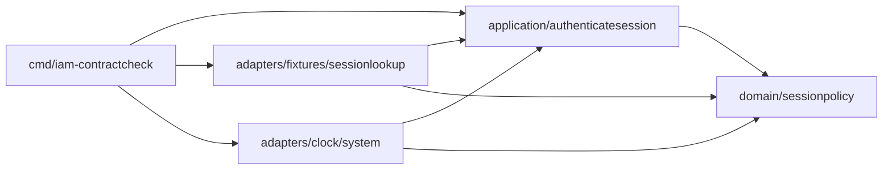

# HIT-22 — карта фактического IAM-модуля

Владелец/автор участка: Дмитрий Карачебан; реализация подготовлена агентом Codex. Source of actual imports: `evidence/d1-imports.log` (`go list -json ./...`, exact source `2cd7c032e8ede98c75181599b440e97657bff197`). Status всех пяти package: IMPLEMENTED / SELF_CHECKED / HUMAN_REVIEW_PENDING. Нет состояния Accepted или production deployed.

| Package / путь под services/iam | Ответственность / публичный контракт | Прямые внутренние imports |
| --- | --- | --- |
| internal/domain/sessionpolicy | Проверить переданные значения: Evaluate, Snapshot, Observation, Decision | Нет, stdlib time |
| internal/application/authenticatesession | Оркестрация New/Service.Execute; consumer-owned SessionLookup/Clock; Result | domain/sessionpolicy |
| internal/adapters/fixtures/sessionlookup | Строго Decode, NewFile/NewFixed, NewFixedClock; синтетическая замена, value ownership | application/authenticatesession, domain/sessionpolicy |
| internal/adapters/clock/system | Host Clock.Now через явно заданный HealthProbe; без probe unavailable | application/authenticatesession, domain/sessionpolicy |
| cmd/iam-contractcheck | Составить зависимости, выбрать File/Fixed и fixture/system Clock, выполнить один Execute, безопасный вывод/exit | оба adapters и application/authenticatesession |

Легенда: **A→B означает «исходный package A импортирует B»**, не runtime-вызов и не направление данных. Go компиляция/`go list` не допускает import cycle; wrapper дополнительно запрещает concrete adapter imports в domain/application и foreign service internals. Callback через port во время Execute — runtime dependency inversion, не обратный source import. Compile-time interface assertions adapters→application подтверждают совместимость, а consumer не знает File/Fixed/System types.

Requirement→responsibility→operation→consumer: DK-FR-01/02 + HP-BP-001/T/002 → session validity → Evaluate(snapshot, observation) → Service.Execute; DK-FR-03 + T/003 → safe authority orchestration → Execute(ctx, reference) → diagnostic composition root и будущий IAM transport. Диагностический root уже вызывает настоящий consumer, отдельной «учебной копии» policy нет.

Внешние обязанности: SQL authority/tenant/membership/start barriers/OIDC/renewal/fencing — будущие IAM/owner adapters и общая архитектура, а не фиктивные package в этой карте. Другие три backend service и frontend не импортируются. Соседние worktree/PR не редактировались. Модуль и task history сохраняются при переносе Feature в будущий IAM epic.
